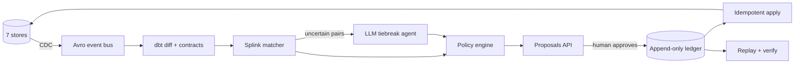
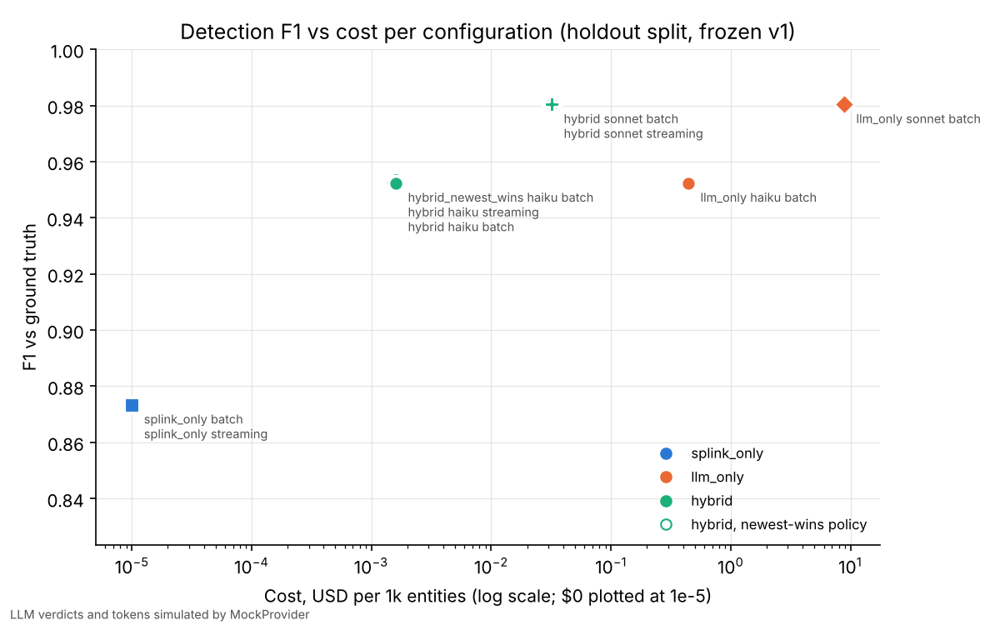
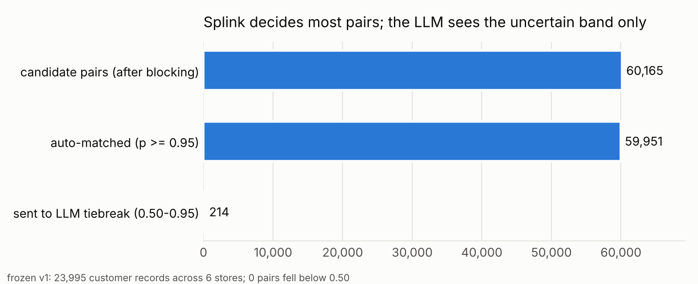
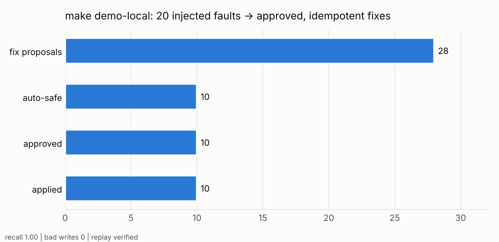

# Cross-Store Reconciliation Agent

> The same customer, order or batch lives in seven systems. This agent finds where they disagree, proves which value is right, and fixes it only after a human approves, with every change on a replayable ledger.


## The problem

Enterprises keep the same entity in Postgres, MongoDB, DynamoDB, Cosmos DB, S3/ADLS Parquet lakes and a CRM. They drift: a typo in one store, a stale address in another, cents in one and dollars in the next, a renamed column, a duplicate customer under a new key. Fixing drift by hand is slow; letting a model write to production directly is unsafe.

## What it does

1. **Captures every change** from all stores as one Avro event (Debezium, DynamoDB Streams, Cosmos DB change feed).
2. **Diffs the stores** in dbt on DuckDB and checks each store against its data contract.
3. **Matches entities** across stores with Splink (Fellegi-Sunter). Only the uncertain band goes to an LLM.
4. **Resolves conflicts** with a deterministic policy (source priority, recency, unit normalization).
5. **Proposes fixes** with evidence and lineage through an approval API.
6. **Applies approved fixes once** (idempotency keys) and records them on an append-only ledger.
7. **Replays** the ledger onto fresh stores to prove every fix is reproducible.



## Results

Benchmark: a seeded synthetic company with **10,063 entities across 7 stores** and **500 injected faults of 8 types** (duplicate, stale, typo, missing, type drift, orphaned, schema drift, unit mismatch). Frozen with a hash; 100 faults held out.



| Config (holdout) | F1 | Cost / 1k entities | Bad writes |
|---|---|---|---|
| Splink only | 0.873 | $0 | 0 |
| **Hybrid: Splink + Haiku 5.5 tiebreak** | **0.952** | **$0.0016** | **0** |
| Hybrid: Splink + Sonnet 5.5 tiebreak | 0.980 | $0.032 | 0 |
| LLM only (Sonnet 5.5) | 0.980 | $8.85 | 0 |

- **Hybrid matches LLM-only accuracy at about 1/280 of the cost.** Splink settles 99.6% of candidate pairs; the LLM sees 214 of 60,165.
- **Zero bad writes.** Only fixes the policy can prove (stores agree, single source, or field override) are auto-approvable; everything else waits for a human.
- **Policy matters.** Swapping source-priority rules for "newest wins" drops the correct-fix rate from 0.77 to 0.68.
- **Streaming latency** from CDC event to detection: p50 33 ms, p95 ~110 ms.





LLM decisions in these runs come from an offline provider (recorded responses, else a seeded simulator), so the benchmark runs without an API key. Full tables: [results/results.md](results/results.md).

## Tech stack

| Area | Tools |
|---|---|
| Core | Python 3.12, Pydantic, SQLAlchemy, uv, ruff, mypy, pytest |
| Stores | Postgres, MongoDB, DynamoDB, Cosmos DB, S3 + ADLS Gen2 (Parquet, Arrow, Iceberg, Delta Lake), Snowflake, HubSpot API |
| Streaming / CDC | Debezium, Kafka / Redpanda, Avro + Schema Registry, DynamoDB Streams, Cosmos DB change feed |
| Data quality | dbt + dbt tests on DuckDB, Great Expectations, data contracts, OpenLineage |
| Matching / AI | Splink (Fellegi-Sunter, blocking rules, EM), LangGraph, Instructor, MCP, Claude Haiku/Sonnet with prompt caching |
| Services | FastAPI approval API, event-sourced ledger with DB-enforced append-only and hash chain |
| Orchestration | Dagster software-defined assets, schedules, sensors; Airflow DAG |
| Observability | OpenTelemetry, Prometheus, Grafana, Langfuse |
| Infra | Terraform (AWS: MSK, RDS, DynamoDB, S3, Glue, Athena, Lambda, SQS, IAM, EKS; Azure: Event Hubs, Cosmos DB, ADLS, Synapse, Functions, Event Grid, Entra workload identity, AKS), Helm, Docker Compose, kind |
| Evals / CI | Inspect AI, promptfoo, GitHub Actions eval gate |

## Quickstart

Runs fully local: SQLite, mongomock, moto and in-memory stand-ins for every store, and an offline LLM provider. No accounts or keys.

```bash
uv sync
make check        # lint, types, tests
make demo-local   # inject 20 faults -> detect -> propose -> approve -> apply -> replay
make eval         # full benchmark -> results/
```

Other entry points:

```bash
make match            # Splink matching on the benchmark
make dbt-build        # dbt models + tests
make dagster-validate # orchestration graph
make up               # full local stack in Docker (Postgres, Mongo, Redpanda, Debezium, Dagster, Grafana, ...)
make bootstrap        # switch to real backends + Claude; see docs/SETUP.md
```

## Repository layout

```
src/xstore/
  entities/       canonical models + per-store mappings
  stores/         one Store protocol, 8 adapters
  cdc/            Avro event bus, DynamoDB Streams + Cosmos change feed adapters
  matching/       Splink matcher
  agent/          LangGraph tiebreak agent, MCP evidence server
  policy/         conflict-resolution engine
  proposals/      FastAPI approval API
  ledger/         append-only ledger, apply, replay
  contracts/      data contract checks
  quality/        Great Expectations + OpenLineage
  orchestration/  Dagster assets
  observability/  tracing + metrics
  pipeline/       end-to-end demo
dbt/  contracts/  policy/  evals/  results/
terraform/aws  terraform/azure  deploy/ (compose, helm, kind)
```

## Design decisions

| Choice | Why |
|---|---|
| Probabilistic matching first, LLM only for the uncertain band | 280x cheaper at the same F1; reproducible |
| Deterministic policy; the agent only *proposes* policy changes | Fixes are explainable and repeatable; humans own the rules |
| Idempotency key claimed inside each store | Retries and replays can't double-apply |
| Append-only ledger enforced by database triggers | Tamper-evident audit trail; full replay |
| Store adapters work on raw records, not cleaned models | Type and schema drift stay visible |
| Data contracts per domain-owned store | Schema drift fails fast and opens a GitHub issue |
| Keyless cloud auth (IRSA, Entra workload identity) | No long-lived secrets |

All 26 decision records: [docs/](docs/). Architecture: [docs/ARCHITECTURE.md](docs/ARCHITECTURE.md). Setup: [docs/SETUP.md](docs/SETUP.md).

## License

MIT
