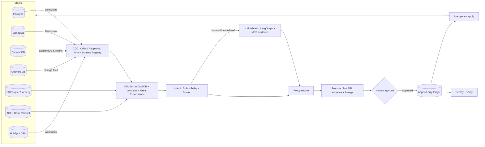

# Architecture

| Step | Code | Notes |
|---|---|---|
| CDC | `src/xstore/cdc/`, `cdc/debezium/`, `cdc/schema-registry/` | One `ChangeEvent` envelope, Avro, in-process bus locally |
| Diff | `dbt/`, `contracts/`, `great_expectations/`, `src/xstore/evals/detection.py` | Staging per store -> reconciled model; contract check fails on schema drift |
| Match | `src/xstore/matching/` | Bands: match >= 0.95, tiebreak 0.50-0.95 |
| Tiebreak | `src/xstore/agent/` | Instructor structured output; confidence < 0.6 -> human |
| Policy | `policy/policy.yaml`, `src/xstore/policy/` | Source priority, recency, overrides, units; agent proposes diffs |
| Propose / approve | `src/xstore/proposals/` | Content-hash ids; only safe proposals auto-approvable |
| Ledger / apply / replay | `src/xstore/ledger/` | DB-enforced append-only, hash chain, `fix:<proposal_id>` idempotency keys |
| Orchestration | `src/xstore/orchestration/`, `orchestration/airflow/` | Dagster assets + schedule + CDC-lag sensor; Airflow mirror |
| Observability | `src/xstore/observability/`, `observability/` | OTel traces, Prometheus metrics, Grafana, Langfuse |
| Deploy | `deploy/`, `terraform/aws/`, `terraform/azure/` | Compose, Helm (EKS/AKS), kind |

Decisions: `docs/ADR-*.md`.
