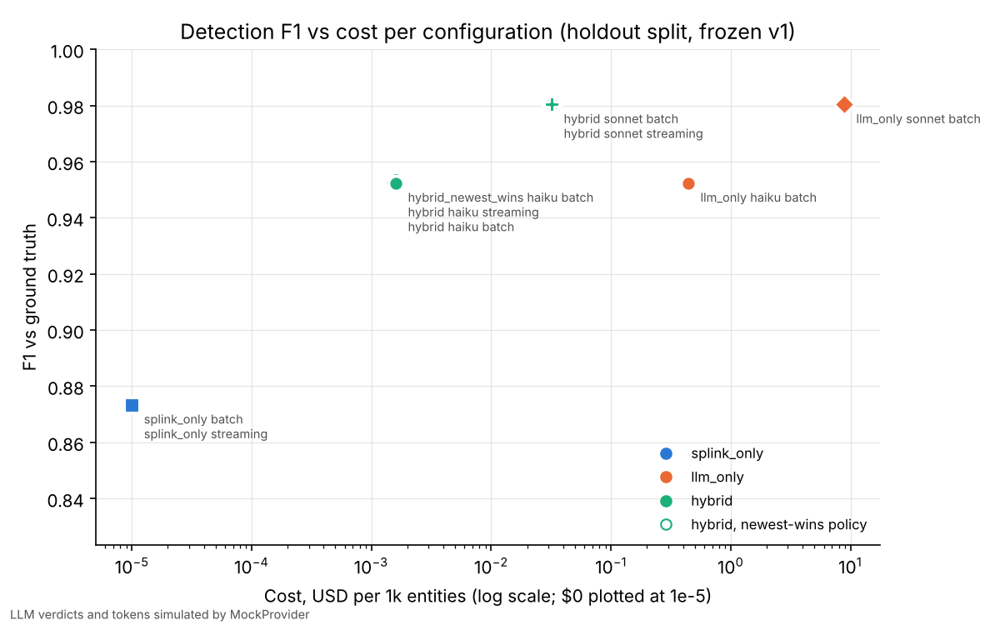

# Eval results

> Agent verdicts and token counts marked `simulated` come from the offline MockProvider (rule-based verdict with a seeded per-model error rate, tokens estimated as chars/4), not from Claude. They measure the harness, not the model.

## Matrix: holdout split

run `20261105T134605Z-holdout`; 10063 entities, 100 labels, 60165 Splink candidate pairs (214 in the tiebreak band); prices as of 2026-11.

| config | model | mode | precision | recall | F1 | $/1k entities | correct fix | bad write | approvals | note |
|---|---|---|---|---|---|---|---|---|---|---|
| splink_only | none | batch | 0.775 | 1.000 | 0.873 | 0.00000 | 0.769 | 0.000 | 103 | no LLM |
| splink_only | none | streaming | 0.775 | 1.000 | 0.873 | 0.00000 | 0.769 | 0.000 | 103 | no LLM |
| llm_only | haiku | batch | 0.909 | 1.000 | 0.952 | 0.44256 | 0.769 | 0.000 | 84 | simulated |
| llm_only | sonnet | batch | 0.962 | 1.000 | 0.980 | 8.84749 | 0.769 | 0.000 | 78 | simulated |
| hybrid_newest_wins | haiku | batch | 0.909 | 1.000 | 0.952 | 0.00160 | 0.677 | 0.000 | 90 | simulated |
| hybrid | sonnet | batch | 0.962 | 1.000 | 0.980 | 0.03200 | 0.769 | 0.000 | 78 | simulated |
| hybrid | sonnet | streaming | 0.962 | 1.000 | 0.980 | 0.03200 | 0.769 | 0.000 | 78 | simulated |
| hybrid | haiku | streaming | 0.909 | 1.000 | 0.952 | 0.00160 | 0.769 | 0.000 | 84 | simulated |
| hybrid | haiku | batch | 0.909 | 1.000 | 0.952 | 0.00160 | 0.769 | 0.000 | 84 | simulated |

## Matrix: train split

run `20261105T134531Z-train`; 10063 entities, 400 labels, 60165 Splink candidate pairs (214 in the tiebreak band); prices as of 2026-11.

| config | model | mode | precision | recall | F1 | $/1k entities | correct fix | bad write | approvals | note |
|---|---|---|---|---|---|---|---|---|---|---|
| splink_only | none | batch | 0.932 | 1.000 | 0.965 | 0.00000 | 0.806 | 0.000 | 353 | no LLM |
| splink_only | none | streaming | 0.932 | 1.000 | 0.965 | 0.00000 | 0.806 | 0.000 | 353 | no LLM |
| llm_only | haiku | batch | 0.976 | 1.000 | 0.988 | 0.44256 | 0.806 | 0.000 | 334 | simulated |
| llm_only | sonnet | batch | 0.990 | 1.000 | 0.995 | 8.84749 | 0.806 | 0.000 | 328 | simulated |
| hybrid_newest_wins | haiku | batch | 0.976 | 1.000 | 0.988 | 0.00160 | 0.737 | 0.000 | 350 | simulated |
| hybrid | sonnet | batch | 0.990 | 1.000 | 0.995 | 0.03200 | 0.806 | 0.000 | 328 | simulated |
| hybrid | sonnet | streaming | 0.990 | 1.000 | 0.995 | 0.03200 | 0.806 | 0.000 | 328 | simulated |
| hybrid | haiku | streaming | 0.976 | 1.000 | 0.988 | 0.00160 | 0.806 | 0.000 | 334 | simulated |
| hybrid | haiku | batch | 0.976 | 1.000 | 0.988 | 0.00160 | 0.806 | 0.000 | 334 | simulated |

## Per-type precision / recall: hybrid / haiku / batch

| type | holdout P | train P | holdout R | train R |
|---|---|---|---|---|
| duplicate | 0.615 | 0.825 | 1.000 | 1.000 |
| stale | 1.000 | 1.000 | 1.000 | 1.000 |
| typo | 1.000 | 1.000 | 1.000 | 1.000 |
| missing | 1.000 | 1.000 | 1.000 | 1.000 |
| type_drift | 1.000 | 1.000 | 1.000 | 1.000 |
| orphaned | 1.000 | 1.000 | 1.000 | 1.000 |
| schema_drift | 1.000 | 1.000 | 1.000 | 1.000 |
| unit_mismatch | 1.000 | 1.000 | 1.000 | 1.000 |

## Cost

| split | config | agent calls | input tok | output tok | cache read tok | cache write tok | LLM $ | $/1k entities | ledger $ DynamoDB | ledger $ Cosmos DB |
|---|---|---|---|---|---|---|---|---|---|---|
| holdout | splink_only / none / batch | 0 | 0 | 0 | 0 | 0 | 0.0000 | 0.00000 | 0.000081 | 0.000177 |
| holdout | splink_only / none / streaming | 0 | 0 | 0 | 0 | 0 | 0.0000 | 0.00000 | 0.000081 | 0.000177 |
| holdout | llm_only / haiku / batch | 60165 | 24680158 | 2714543 | 62811216 | 1044 | 4.4535 | 0.44256 | 0.000069 | 0.000151 |
| holdout | llm_only / sonnet / batch | 60165 | 24680158 | 2710709 | 62811216 | 1044 | 89.0323 | 8.84749 | 0.000065 | 0.000143 |
| holdout | hybrid_newest_wins / haiku / batch | 214 | 88508 | 9790 | 222372 | 1044 | 0.0161 | 0.00160 | 0.000069 | 0.000151 |
| holdout | hybrid / sonnet / batch | 214 | 88508 | 9795 | 222372 | 1044 | 0.3221 | 0.03200 | 0.000065 | 0.000143 |
| holdout | hybrid / sonnet / streaming | 214 | 88508 | 9795 | 222372 | 1044 | 0.3221 | 0.03200 | 0.000065 | 0.000143 |
| holdout | hybrid / haiku / streaming | 214 | 88508 | 9790 | 222372 | 1044 | 0.0161 | 0.00160 | 0.000069 | 0.000151 |
| holdout | hybrid / haiku / batch | 214 | 88508 | 9790 | 222372 | 1044 | 0.0161 | 0.00160 | 0.000069 | 0.000151 |
| train | splink_only / none / batch | 0 | 0 | 0 | 0 | 0 | 0.0000 | 0.00000 | 0.000268 | 0.000590 |
| train | splink_only / none / streaming | 0 | 0 | 0 | 0 | 0 | 0.0000 | 0.00000 | 0.000268 | 0.000590 |
| train | llm_only / haiku / batch | 60165 | 24680158 | 2714543 | 62811216 | 1044 | 4.4535 | 0.44256 | 0.000256 | 0.000564 |
| train | llm_only / sonnet / batch | 60165 | 24680158 | 2710709 | 62811216 | 1044 | 89.0323 | 8.84749 | 0.000253 | 0.000556 |
| train | hybrid_newest_wins / haiku / batch | 214 | 88508 | 9790 | 222372 | 1044 | 0.0161 | 0.00160 | 0.000256 | 0.000564 |
| train | hybrid / sonnet / batch | 214 | 88508 | 9795 | 222372 | 1044 | 0.3221 | 0.03200 | 0.000253 | 0.000556 |
| train | hybrid / sonnet / streaming | 214 | 88508 | 9795 | 222372 | 1044 | 0.3221 | 0.03200 | 0.000253 | 0.000556 |
| train | hybrid / haiku / streaming | 214 | 88508 | 9790 | 222372 | 1044 | 0.0161 | 0.00160 | 0.000256 | 0.000564 |
| train | hybrid / haiku / batch | 214 | 88508 | 9790 | 222372 | 1044 | 0.0161 | 0.00160 | 0.000256 | 0.000564 |

Token prices: evals/prices.yaml (cache reads and 5-minute cache writes priced separately). Ledger prices are placeholders marked `verify` in that file.
- llm_only: all 300 differing-key pairs judged; 500 of 59865 equal-key pairs sampled, their cost extrapolated x119.7

## Latency

| split | config | p50 ms | p95 ms | measured as |
|---|---|---|---|---|
| holdout | splink_only / none / batch | 4507.6 | 4507.6 | full run (incl. Splink) |
| holdout | splink_only / none / streaming | 27.0 | 49.4 | CDC event -> detection |
| holdout | llm_only / haiku / batch | 7724.2 | 7724.2 | full run (incl. Splink) |
| holdout | llm_only / sonnet / batch | 7810.8 | 7810.8 | full run (incl. Splink) |
| holdout | hybrid_newest_wins / haiku / batch | 5345.2 | 5345.2 | full run (incl. Splink) |
| holdout | hybrid / sonnet / batch | 5346.4 | 5346.4 | full run (incl. Splink) |
| holdout | hybrid / sonnet / streaming | 35.2 | 110.9 | CDC event -> detection |
| holdout | hybrid / haiku / streaming | 35.8 | 131.1 | CDC event -> detection |
| holdout | hybrid / haiku / batch | 5422.9 | 5422.9 | full run (incl. Splink) |
| train | splink_only / none / batch | 4427.0 | 4427.0 | full run (incl. Splink) |
| train | splink_only / none / streaming | 25.8 | 46.9 | CDC event -> detection |
| train | llm_only / haiku / batch | 7833.3 | 7833.3 | full run (incl. Splink) |
| train | llm_only / sonnet / batch | 7793.8 | 7793.8 | full run (incl. Splink) |
| train | hybrid_newest_wins / haiku / batch | 5389.4 | 5389.4 | full run (incl. Splink) |
| train | hybrid / sonnet / batch | 5374.9 | 5374.9 | full run (incl. Splink) |
| train | hybrid / sonnet / streaming | 33.0 | 108.4 | CDC event -> detection |
| train | hybrid / haiku / streaming | 34.2 | 107.0 | CDC event -> detection |
| train | hybrid / haiku / batch | 5332.3 | 5332.3 | full run (incl. Splink) |

